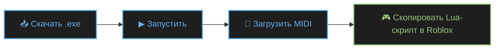
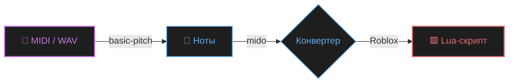

<div align="center">


<br>

**🎹 MIDI → Roblox Piano**

<br>

<a href="https://github.com/SMisha2/AstraConv/releases/latest">
  
</a>
<a href="#-quick-start">
  
</a>
<a href="#-demo">
  
</a>
<a href="https://github.com/SMisha2/AstraConv/issues/new/choose">
  
</a>
<a href="https://github.com/SMisha2/AstraConv/stargazers">
  
</a>

<br><br>

<sub>


</sub>

</div>

<br>

> [!IMPORTANT]
> **Перед скачиванием — прочитайте:**
> - 🔒 **Никакой телеметрии.** AstraConv работает полностью локально и не отправляет ваши MIDI-файлы на серверы.
> - 🛡 **Антивирус может ругаться.** Это ложное срабатывание PyInstaller. Инструкция — в [FAQ](#-faq).
> - ⚠️ **Используйте на свой риск.** Автоматизация может нарушать правила Roblox. Подробнее — в [Дисклеймере](#-дисклеймер).

<br>

---

## 🎬 Демо

<div align="center">

<!-- TODO: заменить на реальный GIF/MP4 (10–15 сек, <10 МБ) -->


<sub><i>Загрузите MIDI → выберите Roblox → скопируйте Lua-скрипт</i></sub>

</div>

<br>

---

## 🆕 Что нового в v0.0.6

- 🎼 **4 уровня детализации** (low / medium / high / ultra)
- 🔗 **Умная группировка** нот в аккорды
- 🎨 **Реал-тайм визуализация** на виртуальной клавиатуре
- 🎵 **Воспроизведение MIDI** через SoundFont (FluidSynth + pygame)

→ Полная история: [CHANGELOG.md](CHANGELOG.md)

<br>

---

## 🎯 Что такое AstraConv

**AstraConv** — это Windows-приложение, которое конвертирует **MIDI-файлы в готовый Lua-скрипт для Roblox Piano**. Один клик — и мелодия превращается в код, который можно вставить в игру.

Помимо конвертации — это **полноценная студия**: воспроизводит MIDI через SoundFont, визуализирует ноты в реальном времени и поддерживает 4 уровня детализации для точного контроля над результатом.

<br>

---

## 🌟 Возможности

<table>
<tr>
<td width="50%" valign="top">

### 🎮 Roblox Piano
- 🟥 **Готовый Lua-скрипт** для Roblox Piano
- 🎚️ Авто-выбор инструмента по громкости
- 📏 Полный диапазон C1–C7
- ⚡ Автоматическое воспроизведение в игре

### 🎼 Обработка MIDI
- 🎯 **4 уровня детализации**
- 🔗 Умная группировка в аккорды
- ⚙️ Настраиваемый порог аккордов
- 📏 Ограничение количества нот
- 🎵 Точная конвертация с учётом BPM

</td>
<td width="50%" valign="top">

### 🎹 Аудио и визуализация
- 🎼 **Воспроизведение MIDI** (SoundFont)
- 🎨 **Реал-тайм визуализация** на клавиатуре
- ✨ Подсветка играющих нот
- 🔊 FluidSynth + pygame

### 🎨 Интерфейс
- 🌑 **Тёмная тема** (One Dark Pro)
- ⭐ Анимированный звёздный фон
- 📑 Боковая навигация
- 🌈 5 акцентных цветов
- ⌨️ Горячие клавиши для всего

</td>
</tr>
</table>

<br>

---

## ⚡ Quick Start



1. Откройте [**Releases**](https://github.com/SMisha2/AstraConv/releases/latest) → скачайте `AstraConv.exe`
2. Запустите — установка не требуется
3. Загрузите `.mid` файл → выберите **Roblox** → скопируйте сгенерированный Lua-скрипт → вставьте в игру

> 💡 Первый запуск? Возьмите готовый пример из [`examples/`](examples/).

<br>

### 💻 Системные требования

| | |
|:---|:---|
| **ОС** | Windows 10 / 11 (x64) |
| **Место на диске** | ~100 МБ |
| **Дополнительно** | SoundFont-файл (для воспроизведения) |

<br>

---

## 📸 Скриншоты

<div align="center">

<table>
<tr>
<td align="center" width="50%">

<br><br>
<b>🖥️ Главное окно</b>
<br>
<sub>Загрузка MIDI и конвертация</sub>
</td>
<td align="center" width="50%">

<br><br>
<b>⚙️ Настройки</b>
<br>
<sub>Детализация, аккорды, анимации</sub>
</td>
</tr>
<tr>
<td align="center" width="50%">

<br><br>
<b>🎮 Roblox Piano</b>
<br>
<sub>Готовый Lua-скрипт для вставки в игру</sub>
</td>
<td align="center" width="50%">

<br><br>
<b>📊 Визуализация</b>
<br>
<sub>Подсветка клавиш в реальном времени</sub>
</td>
</tr>
</table>

</div>

<br>

---

## 🎮 Roblox Piano

Генерирует готовый **Lua-скрипт** для автоматического воспроизведения:

```lua
-- Roblox Piano Script generated by AstraConv
local piano = workspace.Piano
local notes = {
    {time = 0.00, key = 'Key_C4', velocity = 100},
    {time = 0.50, key = 'Key_E4', velocity = 95},
    {time = 1.00, key = 'Key_G4', velocity = 110},
}

local function playNote(noteData)
    local key = piano:FindFirstChild(noteData.key)
    if key then
        key.Transparency = 0.5
        game:GetService("Debris"):AddItem(key, 0.2)
        print("Playing note:", noteData.key)
    end
end
```

> 📏 **Доступный диапазон:** C1–C7 (все MIDI-ноты)

<br>

---

## ⚙️ Настройки

### 🎯 Уровень детализации

| Уровень | Описание |
|:---:|:---|
| **low** | Минимальная — группирует близкие ноты, объединяет до 3 нот в аккорд |
| **medium** | Стандартная — оптимальный баланс между точностью и читаемостью |
| **high** | Максимальная — каждая нота отдельно, аккорды сохраняются |
| **ultra** | Экстремальная — без какой-либо оптимизации |

### 🔗 Порог аккордов

Определяет, насколько близко по времени должны идти ноты, чтобы считаться одним аккордом.

```text
0.01с  ─── Точные аккорды (для чётких MIDI)
0.025с ─── Стандарт ✅
0.05с  ─── Мягкая группировка
0.10с  ─── Максимальное объединение
```

<br>

---

## ⌨️ Горячие клавиши

<div align="center">

| | | | |
|:---:|:---|:---:|:---|
| <kbd>Ctrl</kbd>+<kbd>R</kbd> | 🎵 Roblox | <kbd>Ctrl</kbd>+<kbd>O</kbd> | 📂 Открыть MIDI |
| <kbd>Ctrl</kbd>+<kbd>S</kbd> | 💾 Сохранить | <kbd>Ctrl</kbd>+<kbd>C</kbd> | 📋 Копировать |

</div>

<br>

---

## 🎼 Поддерживаемые MIDI и пайплайн

AstraConv использует **[basic-pitch](https://github.com/spotify/basic-pitch)** от Spotify для анализа аудио и **mido** для работы с MIDI-файлами.



**Поддерживаемые форматы:** `.mid`, `.midi`

<br>

---

## ❓ FAQ

<details>
<summary><b>🛡 Антивирус удаляет AstraConv.exe</b></summary>
<br>

Ложное срабатывание PyInstaller. Добавьте файл в исключения:

**Windows Defender → Защита от вирусов → Исключения → Добавить файл.**

Если не помогает — соберите `.exe` сами (см. блок ниже) или запустите из исходников.

</details>

<details>
<summary><b>🎼 MIDI не загружается или результат пустой</b></summary>
<br>

Проверьте, что MIDI содержит хотя бы один `note_on` с `velocity > 0`. Пустые дорожки игнорируются. Убедитесь, что ноты попадают в диапазон Roblox: **C1–C7** (полный MIDI-диапазон).

</details>

<details>
<summary><b>🎵 Не воспроизводится MIDI в приложении</b></summary>
<br>

Нужны три компонента:

```bash
pip install pygame midi2audio
```

И **SoundFont-файл** (`FluidR3_GM.sf2`). Положите его в одну из папок:

- `%USERPROFILE%\Documents\SoundFonts\`
- `%USERPROFILE%\SoundFonts\`
- `C:\SoundFonts\`
- рядом с `.exe`

</details>

<details>
<summary><b>📊 Визуализация не подсвечивает клавиши</b></summary>
<br>

Визуализация работает в тестовом режиме и подсвечивает только первые 15 клавиш. Для полноценной работы нужен загруженный MIDI-файл.

</details>

<details>
<summary><b>🔧 Ошибка <code>ImportError: No module named 'mido'</code></b></summary>
<br>

Установите зависимости:

```bash
pip install mido
```

При запуске из `.exe` эта ошибка невозможна — все зависимости встроены.

</details>

<br>

---

## 🚀 Установка из исходников

```bash
# 1. Клонируйте репозиторий
git clone https://github.com/SMisha2/AstraConv.git
cd AstraConv

# 2. Установите зависимости
pip install -r requirements.txt

# 3. Запустите
python AstraConv.py
```

<details>
<summary><b>🛠️ Сборка .exe через PyInstaller</b></summary>

<br>

```bat
pip install pyinstaller

pyinstaller --noconfirm --clean --onefile --noconsole ^
    --name AstraConv ^
    --icon "assets/icon.ico" ^
    --collect-all basic_pitch ^
    --collect-all librosa ^
    --collect-all soundfile ^
    --collect-all resampy ^
    --collect-all numba ^
    --collect-all llvmlite ^
    --collect-all pretty_midi ^
    --collect-all mir_eval ^
    --collect-submodules scipy ^
    --hidden-import tkinterdnd2 ^
    --hidden-import mido ^
    --hidden-import onnxruntime ^
    --exclude-module tensorflow ^
    --exclude-module keras ^
    --exclude-module torch ^
    --exclude-module matplotlib ^
    --exclude-module pandas ^
    --exclude-module PyQt5 ^
    --exclude-module PyQt6 ^
    AstraConv.py
```

Готовый файл появится в `dist/AstraConv.exe`.

</details>

<br>

---

## 🗺 Roadmap

- [ ] **Обратная конвертация**: Lua-скрипт → MIDI
- [ ] **Пакетная обработка**: конвертация целой папки за раз
- [ ] **Пресеты раскладок** для других игр
- [ ] **CLI-режим** для автоматизации
- [ ] **Linux / macOS** поддержка

Есть идея? [Откройте issue](https://github.com/SMisha2/AstraConv/issues/new/choose).

<br>

---

## ⚠️ Known Issues

- **Визуализация** пока работает в тестовом режиме (только первые 15 клавиш).
- **SoundFont** не входит в комплект — его нужно скачать отдельно.
- **Антивирус** может помечать `.exe` (PyInstaller false positive).

<br>

---

## 🛠 Стек

<div align="center">

<p>


</p>

</div>

<br>

---

## 📊 Статистика

<div align="center">


<br><br>

<a href="https://star-history.com/#SMisha2/AstraConv&Date">
  
</a>

</div>

<br>

---

## 🤝 Вклад

**Pull requests приветствуются!** 🎉
По крупным изменениям сначала откройте [issue](https://github.com/SMisha2/AstraConv/issues/new/choose) для обсуждения.

```bash
# Fork → Branch → PR
git checkout -b feature/amazing-feature
git commit -m "feat: add amazing feature"
git push origin feature/amazing-feature
```

Перед PR:
```bash
pip install -r requirements-dev.txt
ruff check .
pytest
```

Подробнее — в [CONTRIBUTING.md](CONTRIBUTING.md).

<br>

---

## ⚠️ Дисклеймер

> AstraConv — инструмент для обучения и развлечения.
> Автоматизация может нарушать правила использования Roblox.
> Автор **не несёт ответственности** за блокировку аккаунтов или другие последствия.
> Используйте на свой страх и риск — предпочтительно в одиночных режимах и личных проектах.

<br>

---

## 📜 Лицензия

Проект распространяется под лицензией **MIT** — используйте, форкайте, модифицируйте свободно.


<br>

---


<div align="center">

<sub>
<b>Автор:</b> <a href="https://github.com/SMisha2">SMisha2</a>
&nbsp;·&nbsp;
<b>Версия:</b> <code>0.0.6</code>
&nbsp;·&nbsp;
<b>Обновлено:</b> 2026
</sub>

<br><br>

<a href="https://github.com/SMisha2/AstraConv/stargazers">
  
</a>

<br><br>

<sub>⬆ <a href="#top">Наверх</a></sub>

</div>
